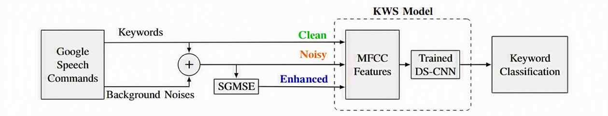

# Noise Robustness in Keyword Spotting

**Authors:** Avital Skop, Ido Ben David
**Supervisor:** Maya Veisman
**Academic Supervisor:** Prof. Sharon Gannot

**[Demo Page](https://avitalskop.github.io/kws-demo/)**

---

## Description

Keyword Spotting (KWS) systems are widely used in voice assistants, smart devices, and embedded speech interfaces. However, their performance can degrade significantly in noisy acoustic environments.

This project investigates whether a speech enhancement front-end can improve keyword recognition robustness under different noise conditions and signal-to-noise ratios (SNRs).

A DS-CNN keyword spotting model trained on clean speech is evaluated under four conditions:

1. Clean speech
2. Noisy speech
3. Speech enhanced using a pretrained SGMSE model
4. Speech enhanced using a project-trained SGMSE model

The goal is to quantify the effect of speech enhancement on downstream keyword recognition and examine the relationship between speech enhancement quality and KWS performance.

---

## Architecture

<p align="center">
  
</p>

The experimental pipeline consists of:

- Google Speech Commands dataset
- Additive noise at multiple SNR levels
- Speech enhancement using SGMSE
- MFCC feature extraction
- DS-CNN keyword spotting
- Evaluation across clean, noisy, and enhanced conditions

The same clean-trained DS-CNN classifier is evaluated under all conditions, allowing the effect of the enhancement stage to be isolated.

---

## Repository Structure

```text
kws_project/
├── code/
│   ├── kws/
│   │   ├── dataset_generation/   # Dataset download and generation
│   │   ├── demo/                 # Demo and example-selection tools
│   │   ├── src/                  # KWS training, evaluation, and metrics
│   │   ├── config.example.yaml   # Example local configuration
│   │   └── requirements.txt
│   │
│   └── sgmse/
│       ├── sgmse/                # SGMSE implementation
│       ├── train.py              # SGMSE training and optional fine-tuning
│       ├── enhancement.py        # Speech enhancement
│       ├── calc_metrics.py       # Enhancement metrics
│       ├── build_sgmse_train_dataset.py
│       ├── kaggle_download_dataset.py
│       └── requirements.txt
│
├── docs/
├── reproducibility/              # Environment record, pinned requirements, final configs, checkpoint hashes
├── tests/                        # CPU-only unittest checks for the KWS entry points
└── README.md
```

Datasets, checkpoints, experiment outputs, logs, and machine-specific configuration files are not tracked by Git.

---

## Installation

Clone the repository:

```bash
git clone https://github.com/MayaVB/kws_project.git
cd kws_project
```

The results were produced with **Python 3.9** and **PyTorch 2.8.0 (CUDA 12.8 build)** on Linux with NVIDIA RTX 2080 Ti GPUs. The full record of the original environments (system details, raw `pip freeze` snapshots, checkpoint hashes) is in [`reproducibility/`](reproducibility/README.md).

### Main Environment (KWS + SGMSE)

A single environment runs both the keyword spotting and the speech enhancement pipelines:

```bash
python3.9 -m venv kws_main_env
source kws_main_env/bin/activate
python -m pip install --upgrade pip
python -m pip install -r reproducibility/requirements/requirements-main.txt
```

`requirements-main.txt` pins the versions observed in the original environment and adds `tabulate`, which the KWS reporting code requires but which was missing from that environment. To rebuild the original environment exactly instead, install from `reproducibility/environment/sgmse_env.pip-freeze.2026-11-08.txt` (and then add `tabulate==0.9.0`).

On Linux x86_64, `torch==2.8.0` from PyPI is the CUDA 12.8 build. The NVIDIA driver must support CUDA 12.8. The system CUDA toolkit is not used.

### Demo Environment (optional)

The local Gradio demo uses a separate environment because it requires numpy 2.x:

```bash
python3.9 -m venv kws_demo_env
source kws_demo_env/bin/activate
python -m pip install -r reproducibility/requirements/requirements-demo.txt
```

### Verify the Installation

With the main environment active, from the repository root (CPU only; no data or GPU needed):

```bash
python -c "import sys, torch; print(sys.version.split()[0], torch.__version__, torch.version.cuda)"
# expected: 3.9.x 2.8.0+cu128 12.8

CUDA_VISIBLE_DEVICES="" python - <<'EOF'
import sys
sys.path[:0] = ["code", "code/kws/src", "code/sgmse"]
import tabulate, analysis_utils, config, dataset, features, models, metrics, train, visualization
import new_noise_dataset, enhanced_dataset, kws.demo.demo_utils
from sgmse.model import ScoreModel
print("main environment OK")
EOF
```

The original, unpinned dependency lists (`code/kws/requirements.txt`, `code/sgmse/requirements.txt`) are kept for reference. `code/sgmse/requirements_version.txt` lists the upstream SGMSE authors' versions, not the versions used in this project.

If you use W&B logging for SGMSE training, run `wandb login` first, or pass `--nolog` to `train.py`.

---

## Dataset Preparation

### 1. Download Google Speech Commands

Google Speech Commands is used as the clean speech dataset.

```bash
python code/kws/dataset_generation/kaggle_download_google_speech_commands.py \
    --output_dir path/to/data
```

### 2. Generate the Noisy Dataset

Noisy speech is generated by mixing clean utterances with background noise at predefined SNR levels.

```bash
python code/kws/dataset_generation/build_noise_dataset.py \
    --clean_root path/to/clean_dataset \
    --output_root path/to/noisy_dataset \
    --meta_path path/to/noisy_metadata.csv
```

The background-noise directory is expected at:

```text
<clean_root>/_background_noise_/
```

The generated dataset contains train, validation, and test subsets.

---

## SGMSE Dataset Preparation

To train or fine-tune SGMSE on the project data, paired clean/noisy training and validation directories are generated using:

```bash
python code/sgmse/build_sgmse_train_dataset.py \
    --clean_root path/to/clean_dataset \
    --noisy_root path/to/noisy_dataset \
    --output_root path/to/sgmse_dataset
```

This produces:

```text
sgmse_dataset/
├── train/
│   ├── clean/
│   └── noisy/
└── valid/
    ├── clean/
    └── noisy/
```

Additional datasets used by the SGMSE experiments can be downloaded from Kaggle using:

```bash
python code/sgmse/kaggle_download_dataset.py \
    --dataset DATASET_IDENTIFIER \
    --output_dir path/to/data
```

For example, VoiceBank-DEMAND can be downloaded using:

```bash
python code/sgmse/kaggle_download_dataset.py \
    --dataset jweiqi/voicebank-demand-16k \
    --output_dir path/to/data
```

---

## Speech Enhancement

The speech enhancement stage is based on the Score-based Generative Model for Speech Enhancement (SGMSE).

Two enhancement configurations are considered.

### Pretrained SGMSE

A pretrained SGMSE+ model trained on VoiceBank-DEMAND is used as the baseline enhancement model.

### Project-Trained SGMSE

SGMSE can be trained on the paired clean/noisy Google Speech Commands data generated for this project.

**Settings of the released checkpoint (historical).** The project checkpoint (`kws_sgmse_trained.ckpt`, epoch 176) was trained with **batch size 1, gradient accumulation 4 (effective batch 4), Adam learning rate 1e-4 and weight decay 0**. These values were recovered from the checkpoint's stored hyperparameters, optimizer state and loop counters; see [`reproducibility/CHECKPOINTS.md`](reproducibility/CHECKPOINTS.md). To retrain with the same settings:

```bash
python code/sgmse/train.py \
    --base_dir path/to/sgmse_dataset \
    --batch_size 1 \
    --accumulate_grad_batches 4 \
    --num_workers 2 \
    --max_epochs 200 \
    --backbone ncsnpp \
    --accelerator cuda \
    --devices 1 \
    --num_eval_files 5 \
    --log_dir path/to/sgmse_logs \
    --wandb_name kws_experiment
```

`--max_epochs 200` is not recorded in the checkpoint. The released checkpoint is from epoch 176, selected by validation loss.

An earlier version of this README gave `--batch_size 2 --accumulate_grad_batches 2`. That has the same effective batch size of 4, but it is not the configuration that produced the released checkpoint, and it is not guaranteed to give numerically equivalent training.

SGMSE training is not seeded, so retraining gives a statistically comparable model, not an identical one.

Training is logged using Weights & Biases unless `--nolog` is specified.

The training pipeline saves periodic checkpoints and can additionally save the best checkpoints according to speech enhancement metrics such as PESQ, ESTOI, SI-SDR, SI-SIR, and SI-SAR.

### Optional Fine-Tuning

The experiments in this project also investigated fine-tuning from the pretrained VoiceBank-DEMAND SGMSE+ checkpoint.

For this configuration, the pretrained checkpoint is loaded as initialization, the majority of the NCSN++ network is frozen, and only the final network blocks (`all_modules.60`–`all_modules.76` and `output_layer`) are updated.

The optional fine-tuning code is included as a commented section in `train.py`. To reproduce this configuration, uncomment the fine-tuning block and use `trainer.fit(model)` instead of the regular `trainer.fit(model, ckpt_path=args.ckpt)` call.

The fine-tuning experiment used:

```bash
python code/sgmse/train.py \
    --base_dir path/to/sgmse_dataset \
    --batch_size 2 \
    --accumulate_grad_batches 2 \
    --num_workers 2 \
    --max_epochs 200 \
    --backbone ncsnpp \
    --accelerator cuda \
    --devices 1 \
    --num_eval_files 5 \
    --log_dir path/to/sgmse_logs \
    --wandb_name kws_finetuning \
    --lr 1e-5 \
    --weight_decay 1e-3 \
    --ckpt path/to/pretrained_checkpoint.ckpt
```

When `--ckpt` is used with the regular training code, PyTorch Lightning treats it as a checkpoint from which to resume training. For the fine-tuning configuration above, the checkpoint is instead explicitly loaded as initialization before freezing the selected layers.

---

## Checkpoints

Two SGMSE checkpoints are provided/referenced for reproducing the experiments.

### Pretrained SGMSE

The pretrained baseline and fine-tuning initialization use the official SGMSE+ VoiceBank-DEMAND checkpoint provided by the original SGMSE authors.

It can be downloaded using:

```bash
gdown 1_H3EXvhcYBhOZ9QNUcD5VZHc6ktrRbwQ
```

See the [official SGMSE repository](https://github.com/sp-uhh/sgmse) for the original model and additional information.

### Project-Trained SGMSE

The selected SGMSE checkpoint obtained using the project data is available on Hugging Face:

**[Download `kws_sgmse_trained.ckpt`](https://huggingface.co/avitalskop/kws-sgmse/blob/main/kws_sgmse_trained.ckpt)**

The checkpoint is not stored directly in this Git repository due to its size.

`kws_sgmse_trained.ckpt` is the epoch-176 checkpoint of the project SGMSE training run (`epoch=176-valid_loss=558.3868.ckpt`); the two local files are byte-identical. It was used for every "project-trained SGMSE" result. Expected SHA-256:

```text
90e19444b5e6c7d9a07cc49543804a02f57717d8d971e45832ee531b447f7af5
```

Enhanced datasets were generated with the default sampler settings of `enhancement.py` (PC sampler, reverse-diffusion predictor, ALD corrector, 1 corrector step, `snr 0.5`, `N 30`). See [`reproducibility/CHECKPOINTS.md`](reproducibility/CHECKPOINTS.md) for all checkpoint hashes and metadata.

Alternatively, SGMSE can be trained from scratch or fine-tuned from the pretrained VoiceBank-DEMAND checkpoint using the instructions above.

---

## Generate Enhanced Speech

An SGMSE checkpoint can be applied to the noisy test set to construct an enhanced dataset:

```bash
python code/kws/dataset_generation/build_enhanced_dataset.py \
    --input_root path/to/noisy_dataset/test \
    --metadata path/to/noisy_metadata.csv \
    --ckpt path/to/checkpoint.ckpt \
    --output_root path/to/enhanced_dataset \
    --output_metadata path/to/enhanced_metadata.csv
```

By default, the script uses:

```text
code/sgmse/enhancement.py
```

A different enhancement script can be provided using `--sgmse_script`.

---

## Keyword Spotting

The keyword recognizer is based on a depthwise separable convolutional neural network (DS-CNN).

The KWS pipeline uses:

- 16 kHz audio
- 13 MFCC coefficients
- Feature standardization based on the clean training set
- DS-CNN trained on clean speech
- Cross-entropy loss
- Adam optimization

The same trained classifier is evaluated on clean, noisy, and enhanced speech.

### Configuration

Create a local configuration file from the provided example:

```bash
cp code/kws/config.example.yaml code/kws/new_config.yaml
```

Edit `new_config.yaml` to specify the local dataset and output paths.

`new_config.yaml` is intentionally ignored by Git, allowing machine-specific paths and experiment settings to remain local.

The optional `enh_new_dir` key (the parent directory of the enhanced datasets) is accepted but currently unused. Configs without it work. Earlier code versions required it and stopped with a `KeyError` when it was missing.

The `random_state` key is also read but currently unused: the train/validation/test split comes from the `split` column of the noisy metadata CSV, and KWS training is not seeded.

### Final Experiment Configurations

The final results include a 30-class experiment and two 6-class experiments. Their configurations, reconstructed from the run outputs and the Git history, are in [`reproducibility/configs/`](reproducibility/configs/):

| Config | Experiment | Original run |
|---|---|---|
| `kws_30class_train.yaml` | 30 classes, train + evaluate | `2026-05-26_18-01-43_all_folders` |
| `kws_30class_eval.yaml` | 30 classes, evaluate the saved model | `2026-05-29_19-14-17_all_annot_false` |
| `kws_6class_bed-bird-dog-go-happy-house.yaml` | 6 classes (A) | `2026-07-07_11-36-05` |
| `kws_6class_go-no-off-on-stop-yes.yaml` | 6 classes (B) | `2026-06-08_12-14-57_presentation` |

These files contain the original absolute paths of the lab machine; adjust them for your setup. The evidence for each value, the results, and the limits on exact reproduction (KWS training is not seeded; SGMSE sampling is stochastic) are documented in [`reproducibility/EXPERIMENTS.md`](reproducibility/EXPERIMENTS.md).

### Train and Evaluate

Run the complete KWS training and evaluation pipeline with:

```bash
python code/kws/src/run_training.py \
    --config code/kws/new_config.yaml
```

The configured evaluation modes include clean, noisy, pretrained-SGMSE-enhanced, and project-trained-SGMSE-enhanced speech.

### Evaluate a Saved Model

To evaluate a saved DS-CNN model (model, scaler and label encoder given by `best_model_path`, `scaler_path` and `label_encoder_path`) without retraining:

```bash
python code/kws/src/run_evaluation_main.py \
    --config reproducibility/configs/kws_30class_eval.yaml
```

If `--config` is omitted, `code/kws/new_config.yaml` is used, as before. This script always evaluates every class in the metadata; `folder_start`, `folder_end` and `selected_folders` are ignored. (The "usage limitation" comment inside `kws_30class_eval.yaml` predates the `--config` option and no longer applies; the historical config files are intentionally left unedited.)

### Tests

CPU-only tests for the entry points (standard-library `unittest`; no GPU or data needed):

```bash
CUDA_VISIBLE_DEVICES="" python -m unittest discover -s tests -t . -v
```

---

## Evaluation

Keyword spotting performance is analyzed using:

- Accuracy
- Confusion matrices
- Per-SNR analysis
- Per-noise analysis
- Example-level prediction analysis

Speech enhancement performance is evaluated using:

- PESQ
- ESTOI
- SI-SDR
- SI-SIR
- SI-SAR

These metrics allow speech quality and interference suppression to be compared with downstream keyword recognition performance.

---

## Demo

An interactive demonstration of selected examples is available at:

**[Noise Robustness in Keyword Spotting – Demo](https://avitalskop.github.io/kws-demo/)**

Demo assets can be regenerated using:

```bash
python code/kws/demo/export_demo_assets.py \
    --metadata path/to/enhanced_metadata.csv \
    --clean_root path/to/clean_dataset \
    --noisy_root path/to/noisy_dataset/test \
    --enhanced_root path/to/enhanced_dataset
```

Interesting examples can also be explored locally using:

```bash
python code/kws/demo/gradio_demo.py \
    --csv path/to/interesting_examples.csv
```

---

## Main Findings

- Background noise significantly degrades keyword recognition performance.
- Speech enhancement improves robustness compared with directly processing noisy speech.
- Both pretrained and project-trained SGMSE models improve KWS performance under noisy conditions.
- Different enhancement checkpoints exhibit different tradeoffs between interference suppression and speech fidelity.
- Improvements in speech enhancement metrics do not always translate directly into improvements in keyword classification.

---

## References

### Google Speech Commands

Warden, P., *Speech Commands: A Dataset for Limited-Vocabulary Speech Recognition*, 2018.
https://arxiv.org/abs/1804.03209

### DS-CNN Keyword Spotting

Zhang, Y. et al., *Hello Edge: Keyword Spotting on Microcontrollers*, 2017.
https://arxiv.org/abs/1711.07128

### SGMSE

Richter, J. et al., *Speech Enhancement and Dereverberation with Diffusion-Based Generative Models*, 2022.
https://arxiv.org/abs/2208.05830